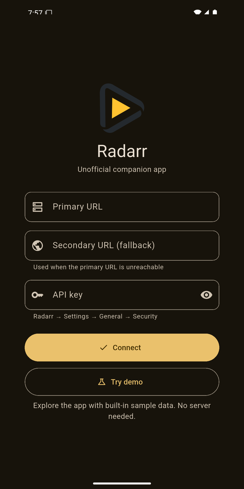
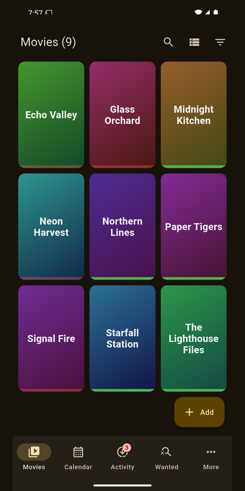
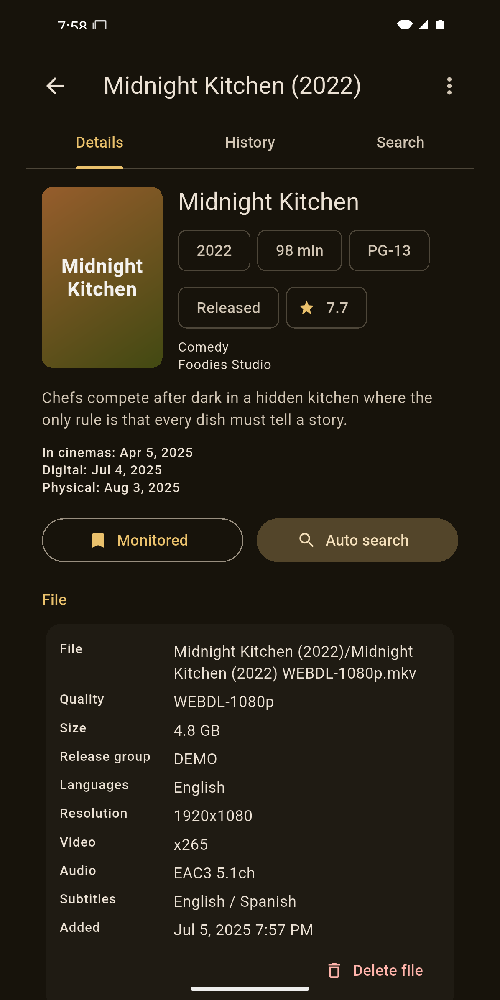
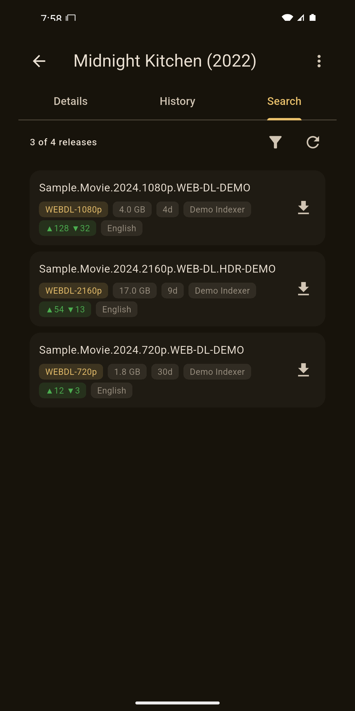
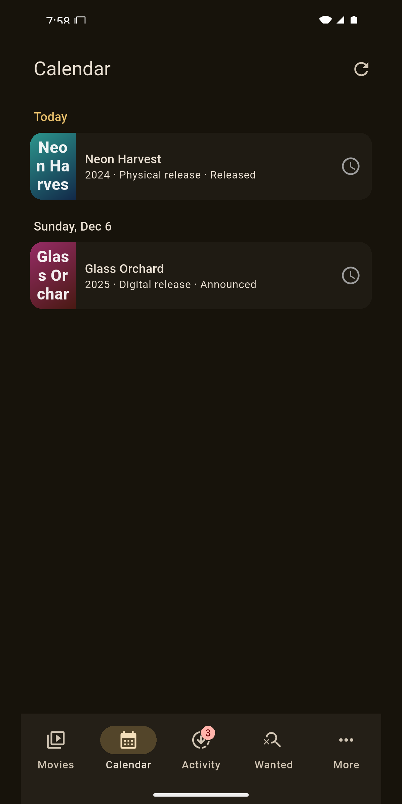
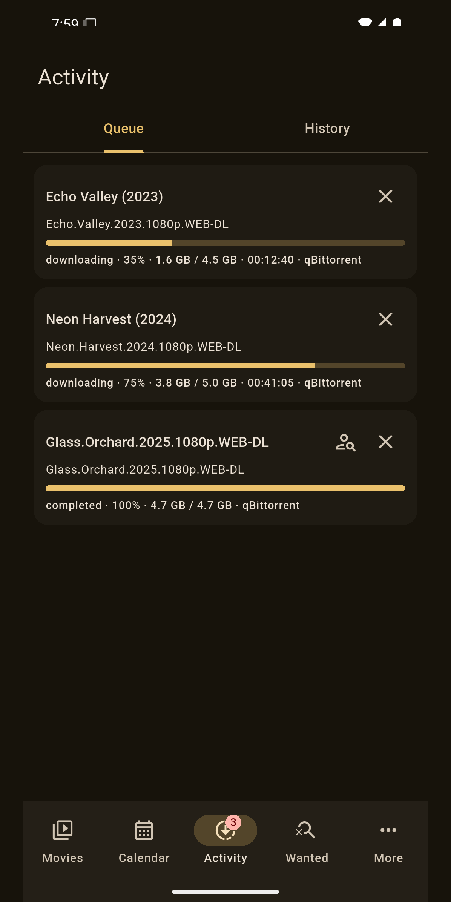
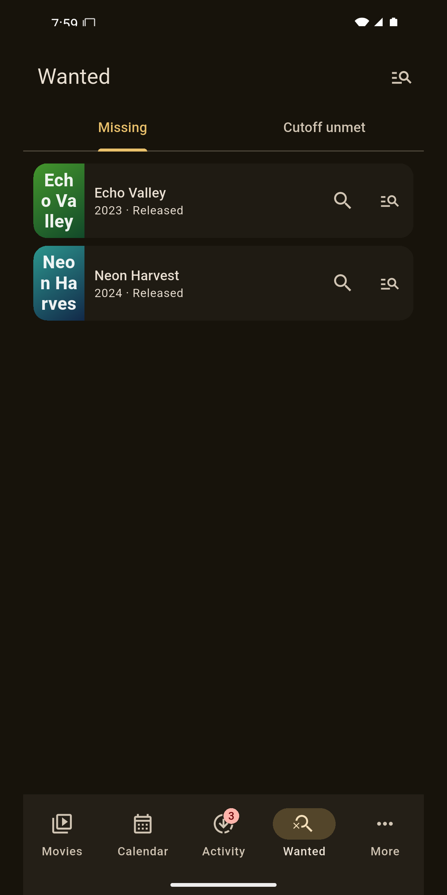
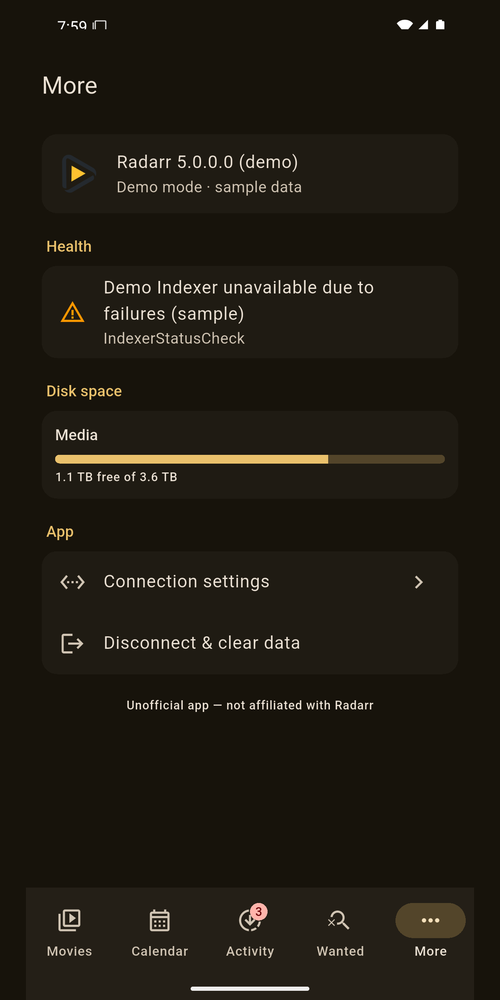

<div align="center">


# Radarr

**An elegant, unofficial Android companion for your Radarr server.**


</div>

> Not affiliated with or endorsed by the Radarr project.

## ✨ Highlights

- **Zero accounts** – no login, no registration, no database. Just your server URL and API key.
- **Try it without a server** – a built-in demo mode with sample data lets you explore every feature before connecting.
- **Resilient connection** – set a primary and a secondary URL (e.g. LAN + public domain); the app fails over automatically.
- **Full-featured** – browse, add, monitor, search and delete movies, check the calendar, queue, history and missing movies.
- **Fast** – library is cached locally and opens instantly, then refreshes in the background.
- **Beautiful** – Material 3, dark theme, poster grid and status bars.

## 📱 Features

| Area | What you can do |
|---|---|
| **Movies** | Poster grid/list, filters, search, download status per movie |
| **Movie detail** | Overview, release dates, file info, monitor toggle, automatic search, refresh, delete, per-movie history, manual (interactive) search with long-running background queries |
| **Add movie** | Lookup by title, `tmdb:ID` or `imdb:ttID`; pick root folder, quality profile, minimum availability and monitor mode |
| **Calendar** | Month grid with cinema, digital and physical releases per day |
| **Activity** | Live download queue (remove/blocklist, badge with the item count on the nav bar), manual import for downloads waiting for user action, and history |
| **Wanted** | Missing and cutoff unmet tabs, search one or all |
| **More** | Server version, health checks, disk space, connection settings |

See [`.docs/FEATURES.md`](.docs/FEATURES.md) for the full list and the API endpoints used.

## 📸 Screenshots

| Setup | Movies | Movie detail | Manual search |
|---|---|---|---|
|  |  |  |  |

| Calendar | Activity | Wanted | More |
|---|---|---|---|
|  |  |  |  |

## 🚀 Getting started

1. Install the app on your Android device.
2. On first launch enter:
   - **Primary URL** – e.g. `http://192.168.1.10:7878`
   - **Secondary URL** *(optional)* – e.g. `https://radarr.example.com`
   - **API key** – Radarr → *Settings → General → Security*
3. Tap **Connect**.

No server handy? Tap **Try demo** to explore the app with built-in sample data.

## 🛠️ Development

```bash
flutter pub get
flutter analyze
flutter test
flutter run
```

> Gradle does not work with JDK 25 yet. Build with JDK 17:
> `JAVA_HOME=/usr/lib/jvm/java-17-openjdk-amd64 flutter build apk`

Project docs live in [`.docs/`](.docs/README.md). API reference: <https://radarr.video/docs/api/>.
